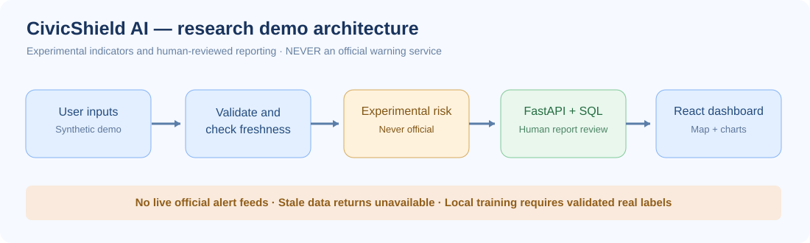
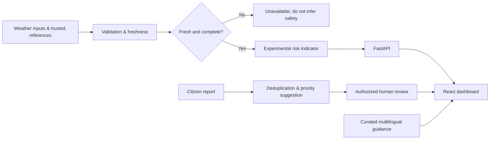

# 🛡️ CivicShield AI

<p align="center">
  
</p>

<p align="center">
  <a href="https://github.com/harshakavali81-collab/CivicShield-AI/actions/workflows/ci.yml"></a>
  
  
  
  
</p>

**Multilingual Public Safety, Disaster Risk Demonstration & Incident Review Platform**

[Architecture](docs/ARCHITECTURE.md) · [Project tree](docs/PROJECT_TREE.md) · [Workflow](docs/PROJECT_WORKFLOW.md) · [API](docs/API_REFERENCE.md) · [Model card](docs/MODEL_CARD.md) · [Safety and privacy](docs/SAFETY_AND_PRIVACY.md) · [Testing](docs/TEST_PLAN.md) · [Visualizations](docs/VISUALIZATIONS.md) · [Deployment](docs/DEPLOYMENT.md) · [Operations](docs/OPERATIONS.md) · [Roadmap](docs/ROADMAP.md)

> **SAFETY NOTICE:** This is a portfolio/research demo, **not** an official warning system, emergency service, evacuation tool, or reliable prediction of disaster safety. Risk indicators are experimental; demo samples are synthetic. Follow official authorities. During emergencies contact local emergency services.

## October 2026 development upgrade

**Implemented:** optional OIDC RS256 audience/issuer/role validation for responder APIs and browser Authorization Code + PKCE integration; a configured IMD district-warning adapter with strict official-code/time validation; CWC official forecast bookmarks; independent geography-and-time model holdout utility; cloud hosting blueprint; safe standalone portfolio page and GitHub Pages manual publishing workflow.

**Not configured or certified:** live IMD account/permission, CWC programmatic data, a trusted IdP tenant, a public API host or a validated disaster-prediction model. All must be arranged before claiming a real emergency warning service.

- [Production deployment instructions](docs/PRODUCTION_SETUP.md)
- [Exact IMD and CWC API responsibilities](docs/IMD_CWC_INTEGRATION.md)
- [Scientific research evaluation CLI](src/civicshield/ml/validate_external.py)
- [Manual informational GitHub Pages workflow](.github/workflows/pages.yml)
- [Render deployment blueprint](render.yaml)
## October 28 reliability upgrade

The project now has **real PostgreSQL/PostGIS CI coverage** for schema migrations and optional indexed radius queries; portable geographic fallback for SQLite/regular PostgreSQL; pseudonymous OIDC reviewer audit records; a read-only diagnostics dashboard; explicit local database-password configuration; and a migration-aware database readiness endpoint. These are software reliability features, **not** certified emergency forecasting.

Start FastAPI locally, then run the read-only portfolio smoke checks:

```bash
python -m scripts.smoke_demo --url http://localhost:8000
```

The smoke CLI confirms that synthetic values are labeled, missing official feeds remain disconnected, and stale sample risk inputs return `unavailable`. No incidents or real alerts are generated.

[Full API reference](docs/API_REFERENCE.md) · [Operator and migration guide](docs/OPERATIONS.md) · [Deployment prerequisites](docs/PRODUCTION_SETUP.md)

## Current engineering status

[](https://github.com/harshakavali81-collab/CivicShield-AI/actions/workflows/ci.yml)

**Local development/research demo, not a deployed public emergency-warning system.** API tests, React build and initial database migration are checked by GitHub Actions. The weather explorer can fetch third-party *modeled* weather when explicitly enabled; official IMD/CWC alerts are **not connected**. No public-safety efficacy is claimed.

## Release 0.2.0 — reproducible portfolio demo

The latest upgrade includes the **interactive fictional Scenario Lab**, a production-configuration preflight checker and stronger audit pseudonym hashing. The CLI provides actionable setup blockers without leaking credentials:

```bash
python -m scripts.doctor --mode local
python -m scripts.doctor --mode production --json
```

For the interview-ready walkthrough, see the [Case study](docs/CASE_STUDY.md), [Changelog](CHANGELOG.md), [Release checklist](docs/RELEASE_CHECKLIST.md), [Security policy](SECURITY.md) and [Contributing guide](CONTRIBUTING.md). A green preflight is a **configuration check only**, not cloud or emergency-service certification.

## New: Interactive fictional case study

**Scenario Lab** opens instantly with 24 hours of deterministic, fully fictional values. It includes an interactive rainfall/report-count chart, four guided engineering stages, and safety/provenance checks. The endpoint is read-only and deliberately makes **no** government calls or incident database writes.

[Full illustrated case study](docs/CASE_STUDY.md) · [Scenario generator](src/civicshield/demo/scenarios.py) · [React Scenario Lab](frontend/src/ScenarioLab.jsx) · [Scenario contract tests](tests/test_scenario_lab.py)

## Visual project gallery

> **Visual integrity:** These SVGs are original **concept illustrations and technical diagrams**, not screenshots of a deployed production service. This is **not an official warning** platform; no images claim real hazard predictions, operational coverage, or validated model accuracy.

| Application concept | Architecture and data flow |
| :---: | :---: |
| [](docs/assets/dashboard-concept.svg) | [](docs/assets/architecture-overview.svg) |
| **[Concept dashboard](docs/assets/dashboard-concept.svg)** · example interface and illustrative data | **[System architecture](docs/assets/architecture-overview.svg)** · trust boundaries and components |

| Human report review | Experimental ML flow |
| :---: | :---: |
| [](docs/assets/incident-workflow.svg) | [](docs/assets/ml-evaluation-flow.svg) |
| **[Incident workflow](docs/assets/incident-workflow.svg)** · review decisions remain human | **[ML evaluation](docs/assets/ml-evaluation-flow.svg)** · no operational accuracy claims |

| Source provenance | Demonstration thresholds |
| :---: | :---: |
| [](docs/assets/source-provenance.svg) | [](docs/assets/risk-thresholds.svg) |
| **[Source attribution](docs/assets/source-provenance.svg)** · disconnected ≠ safe | **[Risk thresholds](docs/assets/risk-thresholds.svg)** · not official warning levels |

[Browse the complete visual gallery](docs/VISUALIZATIONS.md) · [Architecture](docs/ARCHITECTURE.md) · [Actual project tree](docs/PROJECT_TREE.md)

## Features

- **Risk explorer:** explicit, explainable demonstration thresholds; stale inputs are rejected. Optionally use a user-trained supervised model based on legally obtained labeled historical data.
- **Multilingual guidance:** English, Telugu, Hindi, Tamil and Kannada curated preparedness responses; separate searchable source-linked mini library. Not an LLM-based, live official RAG service.
- **Citizen incident reports:** input validation, privacy-conscious storage, duplicate detection, suggested priority and **human-only** review decisions.
- **Responsive React dashboard:** map, incident analytics, actual locally submitted report-count trends, and clearly labeled demo locations. Opt-in provider-backed weather explorer with source attribution.
- **Developer quality:** FastAPI, SQLAlchemy (SQLite local / PostgreSQL for Docker), Alembic initial migration, controlled backups/purge, tests, Docker Compose, CI, architecture diagrams, docs, local experiment graph generator.
- **Safety:** no invented government alerts, no personal phone collection, no public disclosure of exact incident coordinates or narratives, reviewer audit log and optional reporter key. No distributed RBAC/anti-abuse claims.

## Windows one-command setup

Use [Windows quick-start instructions](docs/QUICKSTART_WINDOWS.md). After installing Docker Desktop, clone this repo and run:

```powershell
.\scripts\start-local.ps1
```

This prepares a gitignored local environment, generates a random database password only when missing, and launches the demo at `http://localhost:5173`. The separate **Scenario lab** tab is a complete interactive, fictional case study.

## Quick start

### API (Python 3.11+)

```bash
python -m venv .venv
source .venv/bin/activate   # Windows: .venv\Scripts\activate
pip install -e ".[dev,migrations]"
uvicorn backend.app.main:app --reload
pytest -q
```

Open http://localhost:8000/docs. The local database defaults to SQLite.

### Web dashboard (Node 20+)

```bash
cd frontend
npm install
npm run dev
```

Open http://localhost:5173. Vite proxies `/api` to the FastAPI backend.

### Docker

```bash
cp .env.example .env
docker compose up --build
```

Docker provides PostGIS/PostgreSQL as persistence. Local development is bound to localhost only. Set a strong local `POSTGRES_PASSWORD` in `.env`. Incident submissions are disabled by default in the API unless explicitly enabled. Set a strong `RESPONDER_API_KEY` to enable authenticated review routes. **Do not deploy this configuration to the public internet.**

## Additional working modules

### Third-party modeled weather (opt-in)

Enable `OPEN_METEO_ENABLED=true` in the API process environment or Docker `.env`. This route never returns official warnings and never substitutes synthetic weather for failed provider requests:

~~~bash
curl "http://localhost:8000/api/v1/weather/live?latitude=17.38&longitude=78.48"
~~~

It displays temperature, relative humidity and a 24-hour modeled precipitation accumulation with source timestamp, approximate coordinates and Open-Meteo / CC BY 4.0 attribution. Respect the provider's noncommercial free-tier terms.

### Search curated safety references

~~~bash
curl "http://localhost:8000/api/v1/assistant/knowledge?q=flood"
~~~

Curated mini-corpus, not currently synchronized official warnings.

### Maintenance and experiments

~~~bash
python -m scripts.collect_weather --latitude 17.38 --longitude 78.48
python -m scripts.backup_sqlite
python -m scripts.purge_incidents --days 30           # dry run
python -m scripts.check_data_quality /path/to/labeled.csv
DATABASE_URL=sqlite:///./empty_demo.db alembic upgrade head  # only fresh empty DB
~~~

Add `--confirm` to purge only when you truly intend permanent deletion of old local demo records and their review audit entries. See [operator notes](docs/OPERATIONS.md). Optional `pip install -e ".[explain,tracking]"` enables SHAP/MLflow experiment helpers, not production model operations.

## API examples

```bash
curl -s http://localhost:8000/api/health
curl -s -X POST http://localhost:8000/api/v1/risk/estimate \
  -H "Content-Type: application/json" \
  -d '{"city":"Hyderabad","rainfall_24h_mm":68,"temperature_c":29,"humidity_pct":85,"forecast_age_hours":1}'
```

Risk responses return `source_type`, `is_official_warning: false`, `model_mode`, `data_stale`, and the explanation. Model scores (when configured) are **not calibrated probabilities**.

## Optional model training

Train *only* on your legally obtained, properly labeled real historical observations. The training command intentionally refuses datasets that are too small, invalid or single-class.

```bash
python -m civicshield.ml.train --data /path/to/labeled_history.csv --output artifacts/models/risk_model.joblib
```

Required CSV headers: `observed_at,rainfall_24h_mm,temperature_c,humidity_pct,risk_label` with binary `risk_label` (0/1). Evaluation uses a chronological holdout; data collection, independent geographic validation and calibration are required before any operational use. Set `CIVICSHIELD_MODEL_PATH` explicitly to load a locally trusted model.

## Visual architecture



[Explore system diagrams and experiment graphs](docs/VISUALIZATIONS.md).

## Project workflow



## Limitations and roadmap

This repository provides a locally runnable **demonstration**, not a deployed production emergency service. Live IMD warning feeds, validated forecasting datasets, a genuine generative retrieval-augmented assistant, calibrated models, government integrations, production OIDC/RBAC, distributed anti-abuse controls, accessibility field tests and production monitoring require additional engineering or approvals. Optional SHAP/MLflow code is experimental and not deployed. See [roadmap](docs/ROADMAP.md).

## License

MIT. Maintainers must ensure third-party data terms and local regulations are respected.
