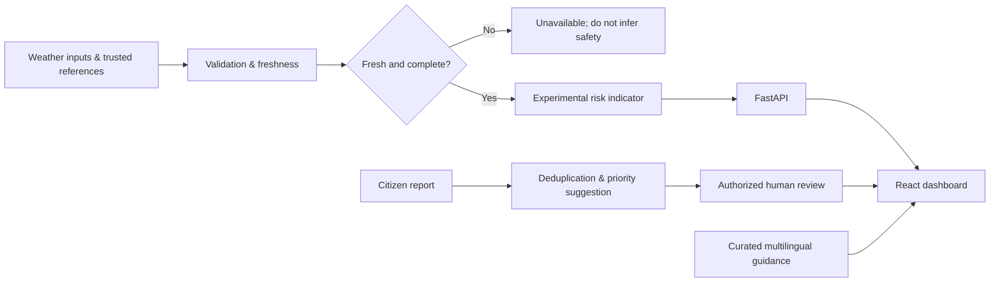

# 🛡️ CivicShield AI

**Multilingual Public Safety, Disaster Risk Demonstration & Incident Review Platform**

[Architecture](docs/ARCHITECTURE.md) · [Project tree](docs/PROJECT_TREE.md) · [Workflow](docs/PROJECT_WORKFLOW.md) · [API](docs/API_REFERENCE.md) · [Model card](docs/MODEL_CARD.md) · [Safety and privacy](docs/SAFETY_AND_PRIVACY.md) · [Testing](docs/TEST_PLAN.md) · [Visualizations](docs/VISUALIZATIONS.md) · [Deployment](docs/DEPLOYMENT.md)

> **SAFETY NOTICE:** This is a portfolio/research demo, **not** an official warning system, emergency service, evacuation tool, or reliable prediction of disaster safety. Risk indicators are experimental; demo samples are synthetic. Follow official authorities. During emergencies contact local emergency services.

## Features

- **Risk explorer:** explicit, explainable demonstration thresholds; stale inputs are rejected. Optionally use a user-trained supervised model based on supplied labeled historical data.
- **Multilingual guidance:** English, Telugu, Hindi, Tamil and Kannada curated preparedness responses. Not a live RAG/official advisory service.
- **Citizen incident reports:** input validation, privacy-conscious storage, duplicate detection, suggested priority and **human-only** review decisions.
- **Responsive React dashboard:** map, incident analytics, trends and source links, with demo data labeled.
- **Developer quality:** FastAPI, SQLAlchemy (SQLite local / PostgreSQL for Docker), tests, Docker Compose, CI, architecture diagrams, docs.
- **Safety:** no invented government alerts, no personal phone collection, no public disclosure of incident coordinates.

## Quick start

### API (Python 3.11+)

```bash
python -m venv .venv
source .venv/bin/activate   # Windows: .venv\Scripts\activate
pip install -e ".[dev]"
uvicorn backend.app.main:app --reload
pytest -q
```

Open http://localhost:8000/docs. The local database defaults to SQLite.

### Web dashboard (Node 20+)

```bash
cd frontend
npm install
npm run dev
```

Open http://localhost:5173. Vite proxies `/api` to the FastAPI backend.

### Docker

```bash
cp .env.example .env
docker compose up --build
```

Docker provides PostGIS/PostgreSQL as persistence. Local development is bound to localhost only. Incident submissions are disabled by default in the API unless explicitly enabled. Set a strong `RESPONDER_API_KEY` to enable authenticated review routes. **Do not deploy this configuration to the public internet.**

## API examples

```bash
curl -s http://localhost:8000/api/health
curl -s -X POST http://localhost:8000/api/v1/risk/estimate \
  -H "Content-Type: application/json" \
  -d '{"city":"Hyderabad","rainfall_24h_mm":68,"temperature_c":29,"humidity_pct":85,"forecast_age_hours":1}'
```

Risk responses return `source_type`, `is_official_warning: false`, `model_mode`, `data_stale`, and the explanation. Model scores (when configured) are **not calibrated probabilities**.

## Optional model training

Train *only* on your legally obtained, properly labeled real historical observations. The training command intentionally refuses datasets that are too small, invalid or single-class.

```bash
python -m civicshield.ml.train --data /path/to/labeled_history.csv --output artifacts/models/risk_model.joblib
```

Required CSV headers: `observed_at,rainfall_24h_mm,temperature_c,humidity_pct,risk_label` with binary `risk_label` (0/1). Evaluation uses a chronological holdout; data collection, independent geographic validation and calibration are required before any operational use. Set `CIVICSHIELD_MODEL_PATH` explicitly to load a locally trusted model.

## Visual architecture


[Explore system diagrams and experiment graphs](docs/VISUALIZATIONS.md).

## Project workflow



## Limitations and roadmap

This repository provides a locally runnable **demonstration**, not a deployed production emergency service. Live IMD warning feeds, validated forecasting datasets, genuine retrieval-augmented generation, SHAP explanations, calibrated models, government integrations, RBAC/OIDC, anti-abuse controls, accessibility field tests and production monitoring require additional integration, evaluation and operational approval. See [roadmap](docs/ROADMAP.md).

## License

MIT. Maintainers must ensure third-party data terms and local regulations are respected.
