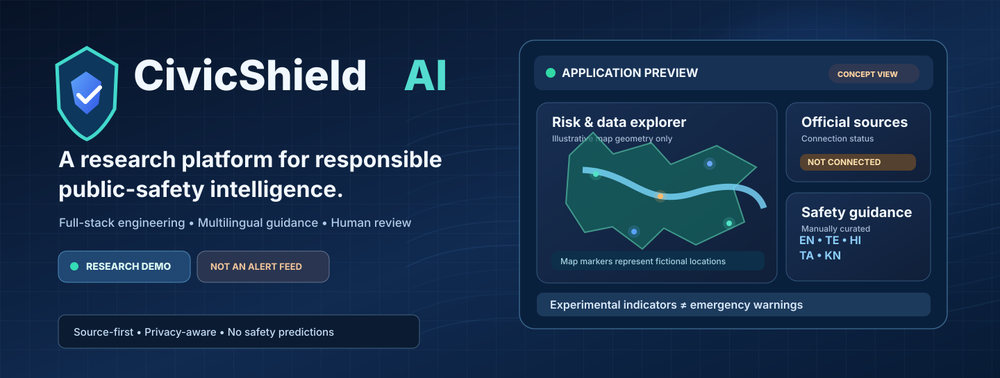
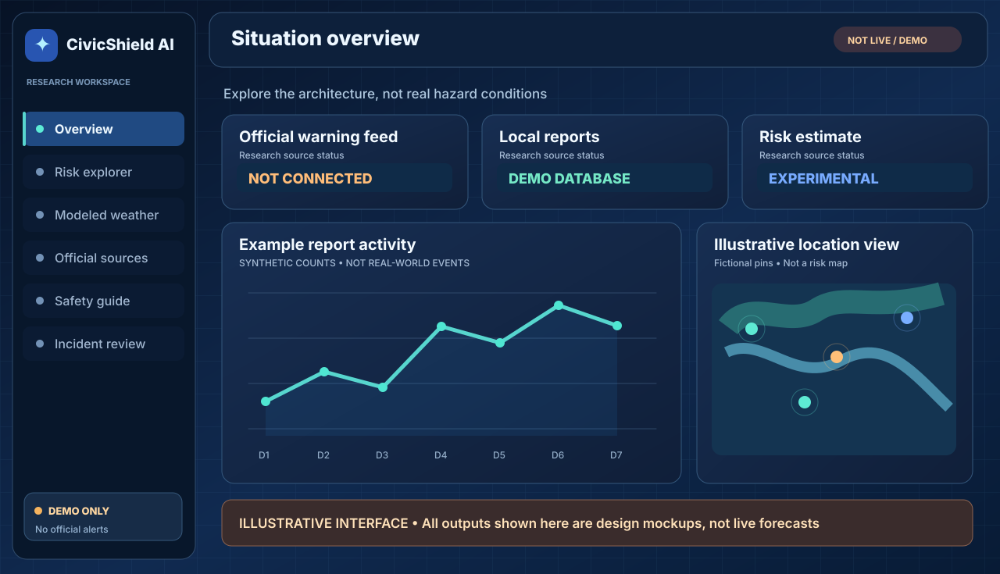
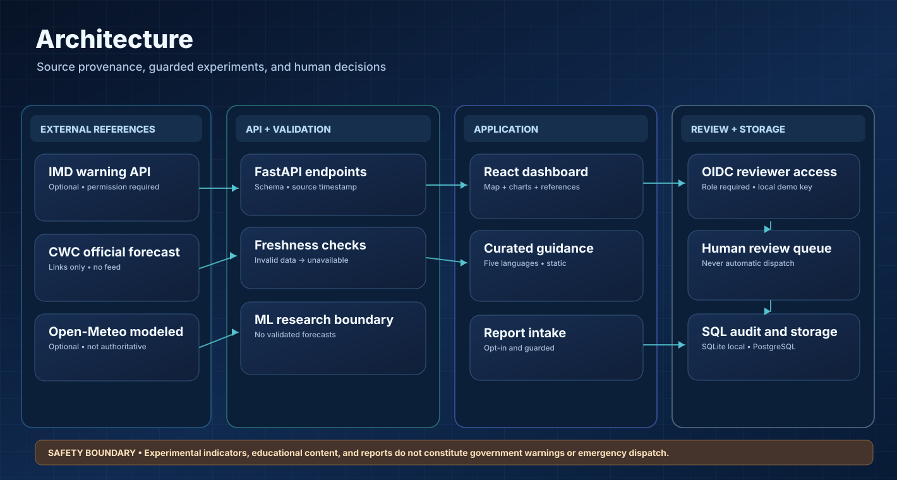
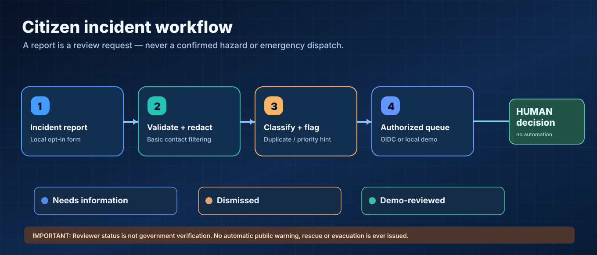
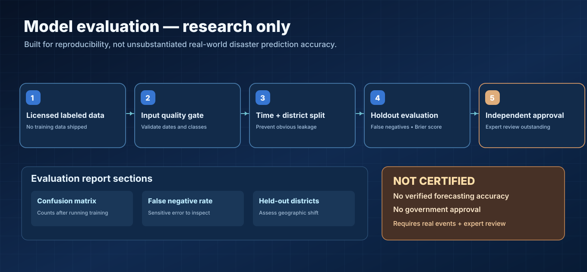
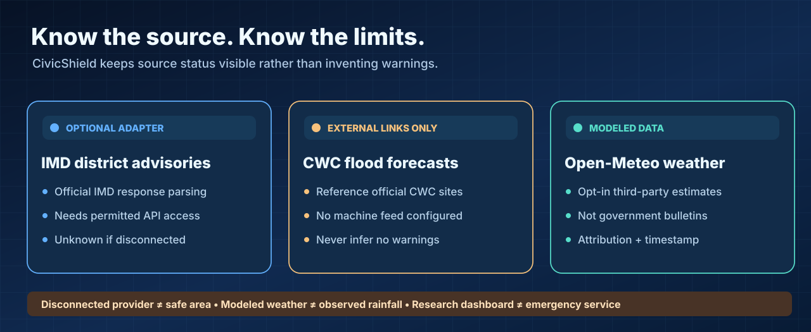
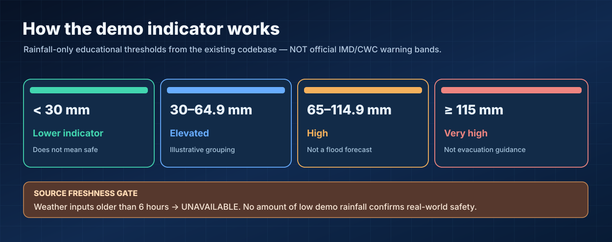

# CivicShield AI — Visual design system and gallery

Seven original, portable SVG illustrations accompany the real software, project documentation, architecture charts and GitHub README. The concept assets are **not measured dashboard screenshots, official warning maps, or real model evaluation reports**.

## Hero banner

## Dashboard design concept

## System architecture

## Human moderation process

## ML research evaluation

## Source provenance map

## Rainfall demonstration thresholds

## Real implementation diagrams

- [Mermaid architecture, trust boundaries and API](ARCHITECTURE.md)
- [Incident status flow, risk estimation and ML experiment sequences](PROJECT_WORKFLOW.md)
- [Model card, documented limitations and uncertainty](MODEL_CARD.md)
- [Actual repository source tree](PROJECT_TREE.md)

## Rendering and licensing

All assets in `docs/assets/` are original editable SVG documents using inline paths and shapes; no fetched photos, external image dependencies, bundled fonts, invented performance scores, or personal data. They appear in GitHub READMEs without a separate rendering service. The portfolio website also carries self-contained copies of selected illustrations.

The vector artwork is published under the repository [MIT license](../LICENSE). Do not replace concept charts with invented evaluation statistics.

---

# Diagrams, graphs and visual outputs

## GitHub-rendered graphs

- [Architecture](ARCHITECTURE.md): component diagram and deployment trust boundaries.
- [Workflow](PROJECT_WORKFLOW.md): rainfall freshness decision tree, report state machine and supervised ML experiment.
- [Model card](MODEL_CARD.md): illustrative rainfall threshold decision tree.
- [Project tree](PROJECT_TREE.md): real source-code folder structure.

GitHub renders fenced Mermaid graphs in these Markdown documents.

## React analytics

The overview includes a responsive time-series area chart and an interactive Leaflet map. **Both use explicitly synthetic/illustrative examples**. The live local incident summary is populated only from entries in the application's database.

## Experiment SVG graphs

Train your own model with legally obtained real labels:

~~~sh
python -m civicshield.ml.train --data /path/to/owned_labeled.csv --output artifacts/models/risk_model.joblib
python scripts/plot_metrics.py artifacts/models/risk_model.metrics.json
~~~

Generated artifacts:
- `artifacts/evaluation_reports/confusion_matrix.svg` — actual vs predicted positive and negative classes.
- `artifacts/evaluation_reports/classification_metrics.svg` — classwise precision and recall.

These charts are **experiment outputs, not official hazard forecasts**. Nothing is pre-generated from made-up performance numbers and the artifacts folder is intentionally not committed. Reporting an evaluation score without its dataset, label provenance, regions, time windows and confidence limitations would be misleading.

## Official information bookmarks

See [Data sources](DATA_SOURCES.md) for IMD, NDMA, CWC and Open Government Data. Linked authority homepages are not ingested current warnings.
